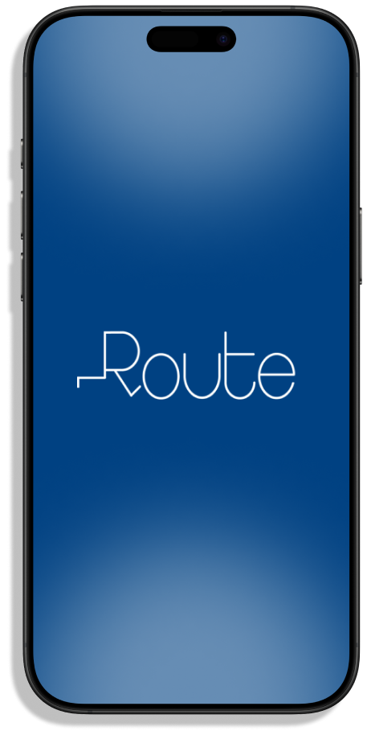
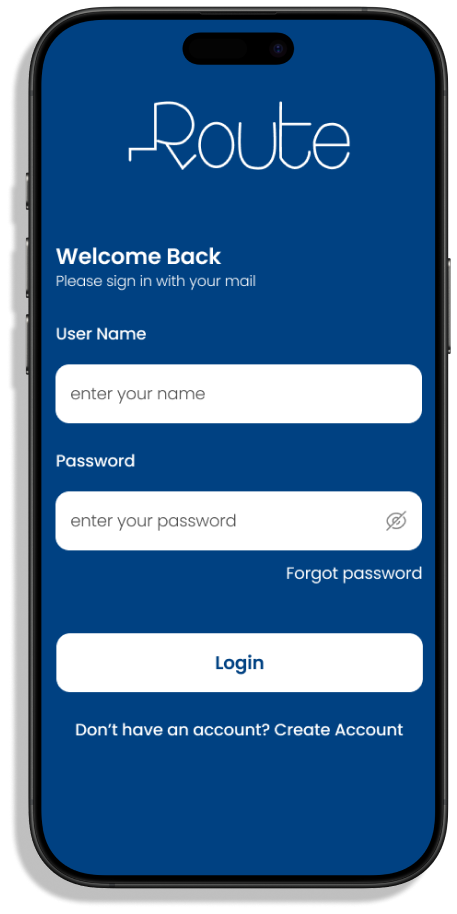
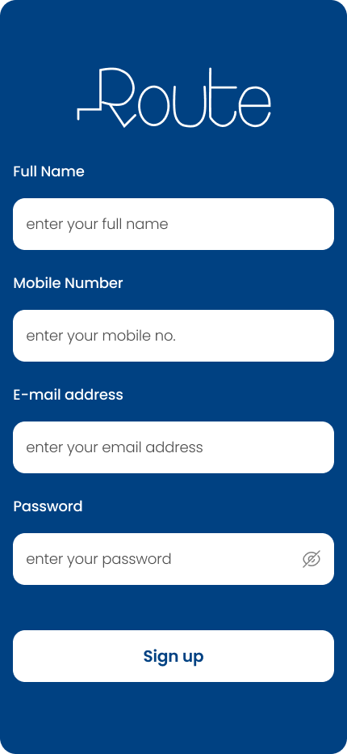
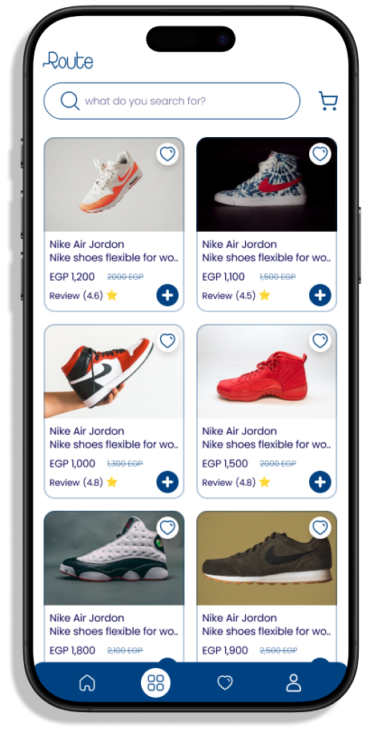
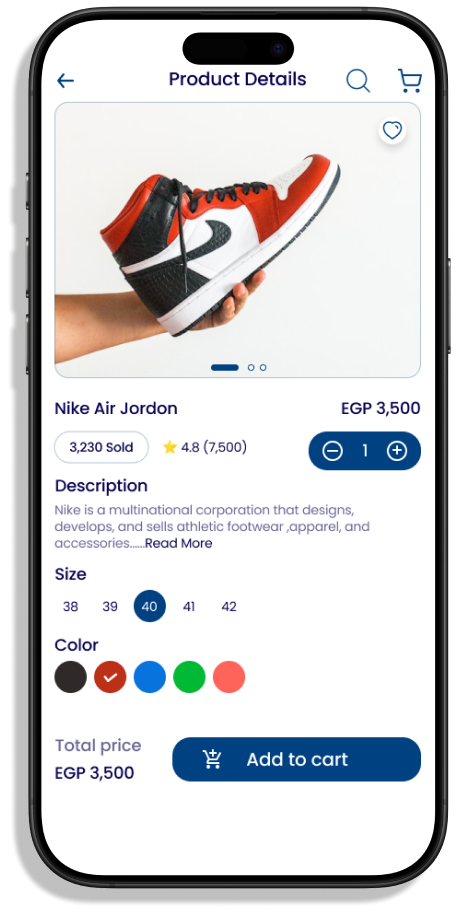
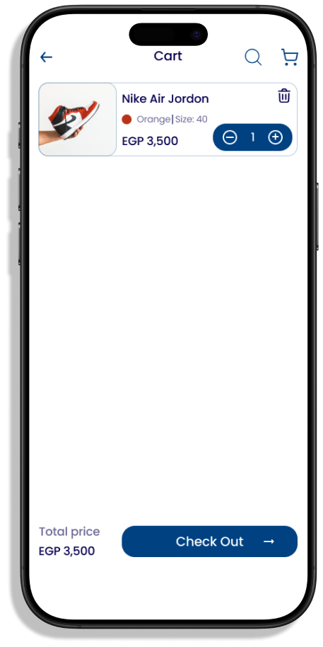
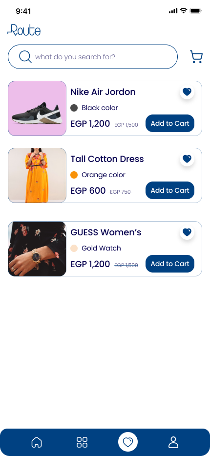
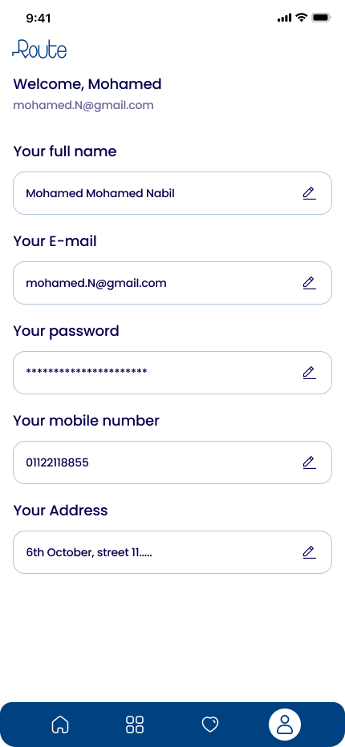

# 🛒 E-Commerce Application

<p align="center">
  
  
  
  
</p>

<p align="center">
  
  
  
  
</p>

---

The **E-Commerce Application** is a Flutter-based app designed to offer a seamless shopping experience. It features user authentication, product browsing, cart management, and more, utilizing the MVVM pattern, BLoC/Cubit for state management, and Clean Architecture for scalability and maintainability.

---

## 📋 Table of Contents

- [Features](#features)
- [Architecture](#architecture)
- [Tech Stack](#tech-stack)
- [Project Structure](#project-structure)
- [Getting Started](#getting-started)
- [Screenshots](#screenshots)
- [Testing](#testing)
- [License](#license)

---

## ✨ Features

### 🛡️ General Features
- **Authentication**:
  - Login and register with email and password via API.
  - Auto-login for a seamless user experience.
- **Favorites Page**: Create a personal wishlist by adding/removing products.
- **Search Functionality**: Search for products via API search queries.
- **Cart Management**: Add items, modify quantities, and remove items from the cart.
- **Profile Page**: Manage and update personal information and preferences.
- **Image Slideshow**: View product images in a slideshow.
- **Item View Page**: Detailed view of individual items, including product specifications, pricing, and availability.
- **Item Selection Page**: Choose product variations (size, color, etc.) before adding to the cart.
- **State Management**: Utilizes BLoC and Cubit for efficient state handling.
- **Clean Architecture**: Ensures separation of concerns for maintainability and scalability.
- **Shared Preferences**: Stores persistent data such as login status and favorites.
- **Dio Package**: Robust API communication using the Dio package.

---

## 🏗️ Architecture

This project follows **Clean Architecture** principles with clear separation of concerns:

```
┌─────────────────────────────────────────────────────────────┐
│                    Presentation Layer                        │
│  ┌─────────────┐  ┌─────────────┐  ┌─────────────────────┐  │
│  │   Screens   │  │   Widgets   │  │   BLoC / Cubit      │  │
│  └─────────────┘  └─────────────┘  └─────────────────────┘  │
├─────────────────────────────────────────────────────────────┤
│                      Domain Layer                            │
│  ┌─────────────┐  ┌─────────────┐  ┌─────────────────────┐  │
│  │  Entities   │  │  Use Cases  │  │ Repository Contracts│  │
│  └─────────────┘  └─────────────┘  └─────────────────────┘  │
├─────────────────────────────────────────────────────────────┤
│                       Data Layer                             │
│  ┌─────────────┐  ┌─────────────┐  ┌─────────────────────┐  │
│  │DTO Models   │  │Data Sources │  │ Repository Impl     │  │
│  └─────────────┘  └─────────────┘  └─────────────────────┘  │
├─────────────────────────────────────────────────────────────┤
│                         Core                                 │
│  ┌─────────────┐  ┌─────────────┐  ┌─────────────────────┐  │
│  │  Resources  │  │   Widgets   │  │   Routes Manager    │  │
│  └─────────────┘  └─────────────┘  └─────────────────────┘  │
└─────────────────────────────────────────────────────────────┘
```

### Architecture Benefits
- ✅ **Testability**: Each layer can be tested independently
- ✅ **Maintainability**: Changes in one layer don't affect others
- ✅ **Scalability**: Easy to add new features
- ✅ **Dependency Inversion**: High-level modules don't depend on low-level modules

---

## 🛠️ Tech Stack

| Category | Technology |
|----------|------------|
| **Framework** | Flutter 3.0+ |
| **Language** | Dart |
| **State Management** | BLoC / Cubit |
| **Architecture** | Clean Architecture + MVVM |
| **Networking** | Dio |
| **Dependency Injection** | get_it + injectable |
| **Local Storage** | SharedPreferences |
| **Navigation** | Named Routes |

---

## 📁 Project Structure

```
lib/
├── core/                    # Core utilities and shared components
│   ├── resources/           # App resources (colors, strings, themes)
│   ├── routes_manager/      # Route definitions and navigation
│   └── widgets/             # Reusable widgets
├── data/                    # Data layer
│   ├── api_constants.dart   # API configuration
│   ├── api_manager.dart     # Dio HTTP client setup
│   ├── endpoints.dart       # API endpoints
│   ├── DTO_models/          # Data Transfer Objects
│   ├── data_sources/        # Remote & local data sources
│   └── repositories/        # Repository implementations
├── di/                      # Dependency Injection
│   ├── di.dart              # DI container setup
│   └── di.config.dart       # Generated DI configuration
├── domain/                  # Domain layer (business logic)
│   ├── failures.dart        # Failure classes for error handling
│   ├── entity_models/       # Business entities
│   ├── repositories/        # Repository contracts (interfaces)
│   └── use_cases/           # Application use cases
├── features/                # Feature modules
│   ├── auth/                # Authentication feature
│   ├── home/                # Home & product browsing
│   └── splash/              # Splash screen
└── main.dart                # Application entry point
```

---

## 🚀 Technologies Used

- **Flutter**: Cross-platform framework for app development.
- **Dio**: For making HTTP requests to the backend API.
- **SharedPreferences**: Persistent local data storage.
- **MVVM Pattern**: Structured codebase by separating UI from business logic.
- **BLoC and Cubit**: Efficient state management across the app.

### Key Dependencies
- **Dio**: HTTP requests.
- **SharedPreferences**: Local storage.
- **Image Slideshow**: To display product images.

---

## 🚀 Getting Started

### Prerequisites

Ensure the following are installed:

- [Flutter](https://flutter.dev/docs/get-started/install) (version 3.0 or later)
- [Dart](https://dart.dev/get-dart)
- RESTful API for backend operations.

### Installation

1. **Clone the Repository**
```bash
git clone https://github.com/NaderEmad9/E-Commerce-App.git
```

2.	**Navigate to the Project Directory**
```bash
cd E-Commerce-App
```

3.	**Install Dependencies**

Run the following command to fetch the required packages:

```bash
flutter pub get
```

4.	**Run the Application**
   
   Use the following command to run the app on your preferred device:
```bash
flutter run
```

---

## 📱 Screenshots

<p align="center">
  
  
  
</p>

<p align="center">
  
  
  
</p>

<p align="center">
  
  
  
</p>

---

## 🧪 Testing

This project ships without a test suite — it was built to demonstrate the architecture
described above. My tested production work is the procurement platform: 118 test cases
run by GitHub Actions on every push, alongside `flutter analyze`.

```bash
flutter analyze
```
---

## 🤝 Contributing

Contributions are welcome! Please feel free to submit a Pull Request.

1. Fork the project
2. Create your feature branch (`git checkout -b feature/AmazingFeature`)
3. Commit your changes (`git commit -m 'Add some AmazingFeature'`)
4. Push to the branch (`git push origin feature/AmazingFeature`)
5. Open a Pull Request

---

## 📄 License

This project is licensed under the MIT License - see the [LICENSE](LICENSE) file for details.

---

<p align="center">
  Made with ❤️ by <a href="https://github.com/NaderEmad9">Nader Emad</a>
</p>
